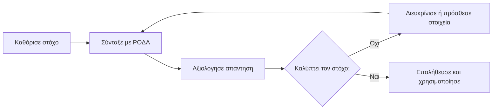

<div align="center">


# ΡΟΔΑ · Prompt Engineering για όλους

### Ρόλος · Οδηγίες · Δεδομένα · Αποτελέσματα

**Το καλό prompt δεν είναι μαγικό. Είναι ξεκάθαρο.**

Ένα ελληνικό, εύχρηστο framework που σε βοηθά να διατυπώνεις πιο σαφή, δομημένα και πρακτικά αιτήματα προς εργαλεία παραγωγικής τεχνητής νοημοσύνης.

[](https://pmoschos.com/roda/)
[](https://pmoschos.com/roda/)
[](https://github.com/pmoschos/roda)

**[🌐 Επισκέψου την ιστοσελίδα](https://pmoschos.com/roda/)** · **[✨ Δοκίμασε τον Prompt Builder](https://pmoschos.com/roda/)**

<sub>Έμπνευση, εκπαίδευση και πρακτική εφαρμογή του Prompt Engineering — χωρίς περιττή πολυπλοκότητα.</sub>

</div>

---

## 📖 Περιεχόμενα

- [Τι είναι το ΡΟΔΑ;](#-τι-είναι-το-ροδα)
- [Τα τέσσερα στοιχεία](#-τα-τέσσερα-στοιχεία)
- [Πριν & μετά: ένα πραγματικό σενάριο](#-πριν--μετά-ένα-πραγματικό-σενάριο)
- [Δοκίμασέ το — Prompt Builder](#-δοκίμασέ-το--prompt-builder)
- [Έτοιμο template](#-έτοιμο-template)
- [Πρακτικά παραδείγματα](#-πρακτικά-παραδείγματα)
- [Πώς βελτιώνεις μια απάντηση](#-πώς-βελτιώνεις-μια-απάντηση)
- [Υπεύθυνη χρήση AI](#-υπεύθυνη-χρήση-ai)
- [Συχνές ερωτήσεις](#-συχνές-ερωτήσεις)
- [Δημιουργός & δικαιώματα](#-δημιουργός--δικαιώματα)

## 💡 Τι είναι το ΡΟΔΑ;

Το **ΡΟΔΑ** δημιουργήθηκε από τον **Παναγιώτη Μόσχο (Panagiotis Moschos)** ως ένα απλό, ελληνικό *mental model* για τη σύνταξη prompts.

Η ιδέα είναι να δίνουμε στο AI όσα θα δίναμε σε έναν συνεργάτη προκειμένου να μας βοηθήσει: **ρόλο ή οπτική γωνία**, **σαφή εργασία**, **κατάλληλα δεδομένα** και **συγκεκριμένες προσδοκίες για το αποτέλεσμα**.

> [!IMPORTANT]
> Το ΡΟΔΑ είναι **οδηγός σκέψης, όχι υποχρεωτική φόρμουλα**. Δεν χρειάζεται κάθε prompt να περιλαμβάνει και τα τέσσερα στοιχεία — ούτε η χρήση τους εγγυάται την ακρίβεια της απάντησης.

## 🧩 Τα τέσσερα στοιχεία

| | Στοιχείο | Βασική ερώτηση | Τι προσθέτει στο prompt |
|:---:|---|---|---|
| 👤 **Ρ** | **Ρόλος** | *Ποιος θέλω να είσαι;* | Οπτική γωνία, ειδικότητα ή επαγγελματικό πλαίσιο. |
| 🎯 **Ο** | **Οδηγίες** | *Τι ακριβώς θέλω να κάνεις;* | Στόχο, επιμέρους εργασίες, περιορισμούς και κριτήρια. |
| 🗂️ **Δ** | **Δεδομένα** | *Με ποιες πληροφορίες θα δουλέψεις;* | Context, πηγές, παραδείγματα και διαθέσιμα στοιχεία. |
| 📋 **Α** | **Αποτελέσματα** | *Πώς θέλω να μου το επιστρέψεις;* | Μορφή, δομή, ύφος, έκταση και επίπεδο λεπτομέρειας. |

<div align="center">

**Ρ + Ο + Δ + Α → πιο ξεκάθαρες οδηγίες → πιο χρήσιμη συνεργασία με το AI**

</div>

### Τι κερδίζεις στην πράξη

- **Λιγότερη ασάφεια:** το μοντέλο γνωρίζει καλύτερα τι ζητάς.
- **Πιο αξιοποιήσιμα αποτελέσματα:** ορίζεις από πριν τη μορφή που χρειάζεσαι.
- **Ευκολότερη επανάληψη:** βελτιώνεις συγκεκριμένα στοιχεία του prompt, αντί να ξεκινάς από το μηδέν.
- **Καλύτερο έλεγχο:** ξεχωρίζεις δεδομένα, περιορισμούς και προσδοκίες.

## 🔍 Πριν & μετά: ένα πραγματικό σενάριο

**Σενάριο:** Θέλεις να απαντήσεις επαγγελματικά σε παράπονο πελάτη.

**❌ Ασαφές prompt**

```text
Απάντησε σε αυτό το παράπονο πελάτη.
```

Το αίτημα δεν ορίζει ύφος, δεδομένα, περιορισμούς ή επιθυμητή μορφή.

**✅ Prompt με το ΡΟΔΑ**

```text
Ρ — Ρόλος
Ενέργησε ως υπεύθυνος εξυπηρέτησης πελατών.

Ο — Οδηγίες
Σύνταξε μία ευγενική, σαφή και επαγγελματική απάντηση.
Δείξε κατανόηση, χωρίς να αποδώσεις ευθύνη που
δεν έχει ακόμη επιβεβαιωθεί.
Μην υποσχεθείς επιστροφή χρημάτων ή αποζημίωση.

Δ — Δεδομένα
Ο πελάτης αναφέρει καθυστέρηση στην εξυπηρέτηση.
Δεν έχει επιβεβαιωθεί ακόμη η αιτία της καθυστέρησης.

Α — Αποτελέσματα
Επίστρεψε ένα email στα ελληνικά, έως 120 λέξεις,
με σύντομο θέμα, ευγενικό ύφος και σαφές επόμενο βήμα.
```

**Η διαφορά:** Το δεύτερο prompt επιτρέπει στο AI να ακολουθήσει συγκεκριμένο στόχο και να αποφύγει περιττές υποθέσεις. Το τελικό κείμενο εξακολουθεί να χρειάζεται έλεγχο.

## 🛠️ Δοκίμασέ το — Prompt Builder

Η ιστοσελίδα περιλαμβάνει **διαδραστικό Prompt Builder** που σε καθοδηγεί στη σύνθεση του δικού σου prompt.

| Δυνατότητα | Τι κάνει |
|---|---|
| 🧩 **Δομημένα πεδία** | Συμπληρώνεις Ρόλο, Οδηγίες, Δεδομένα και Αποτελέσματα. |
| 🎛️ **Επιλογή ύφους** | Προσαρμόζεις τον επιθυμητό τρόπο διατύπωσης. |
| 💡 **Έτοιμο παράδειγμα** | Ξεκινάς γρήγορα με ένα ενδεικτικό σενάριο. |
| 📋 **Αντιγραφή prompt** | Παίρνεις το παραγόμενο κείμενο και το χρησιμοποιείς στο AI εργαλείο της επιλογής σου. |

<div align="center">

### **[🚀 Άνοιξε τον Prompt Builder](https://pmoschos.com/roda/)**

<sub>Ο Builder σε βοηθά να **συντάξεις** ένα prompt· δεν αποτελεί από μόνος του υπηρεσία εκτέλεσης ή αξιολόγησης AI απαντήσεων.</sub>

</div>

## 📝 Έτοιμο template

Το παρακάτω πρότυπο μπορείς να το προσαρμόζεις σε κάθε εργασία:

```text
Ρ — Ρόλος
Ενέργησε ως [ΡΟΛΟΣ / ΟΠΤΙΚΗ ΓΩΝΙΑ].

Ο — Οδηγίες
Στόχος: [ΤΙ ΘΕΛΩ ΝΑ ΠΕΤΥΧΩ].

Κάνε:
- [ΕΡΓΑΣΙΑ 1]
- [ΕΡΓΑΣΙΑ 2]

Περιορισμοί:
- [ΤΙ ΠΡΕΠΕΙ ΝΑ ΤΗΡΗΘΕΙ / ΑΠΟΦΕΥΧΘΕΙ]

Δ — Δεδομένα
Αυτά είναι τα διαθέσιμα στοιχεία:
[ΚΕΙΜΕΝΟ / CONTEXT / ΠΗΓΕΣ]

Αν τα στοιχεία δεν επαρκούν, επισήμανε τι λείπει.
Μην παρουσιάζεις υποθέσεις ως επιβεβαιωμένα γεγονότα.

Α — Αποτελέσματα
Δώσε την απάντηση ως [ΛΙΣΤΑ / ΠΙΝΑΚΑ / EMAIL / ΚΩΔΙΚΑ].
Ύφος: [ΕΠΙΘΥΜΗΤΟ ΥΦΟΣ].
Έκταση: [ΕΠΙΘΥΜΗΤΟ ΜΗΚΟΣ].
Κριτήρια: [ΠΩΣ ΘΑ ΚΡΙΝΩ ΟΤΙ ΕΙΝΑΙ ΧΡΗΣΙΜΟ].
```

> [!TIP]
> Μην προσθέτεις πληροφορίες μόνο για να «γεμίσεις» το template. **Σαφήνεια και συνάφεια** έχουν μεγαλύτερη αξία από το μήκος του prompt.

## 🎓 Πρακτικά παραδείγματα

<details>
<summary><strong>👩‍🏫 Εκπαίδευση — Δημιουργία άσκησης Python</strong></summary>

```text
Ρ: Ενέργησε ως καθηγητής Πληροφορικής.
Ο: Δημιούργησε άσκηση για λίστες στην Python.
Δ: Οι μαθητές γνωρίζουν for, if και βασικές συναρτήσεις.
Α: Δώσε εκφώνηση, 2 παραδείγματα εισόδου/εξόδου,
   3 hints και ενδεικτική λύση σε ξεχωριστή ενότητα.
```

</details>

<details>
<summary><strong>💻 Software Development — Review FastAPI endpoint</strong></summary>

```text
Ρ: Ενέργησε ως senior Python backend engineer.
Ο: Κάνε code review για σαφήνεια, αξιοπιστία,
   ασφάλεια και πιθανά προβλήματα απόδοσης.
Δ: Ακολουθεί το endpoint και οι σχετικές απαιτήσεις:
   [ΕΠΙΚΟΛΛΗΣΕ ΜΗ ΕΥΑΙΣΘΗΤΟ ΚΩΔΙΚΑ / CONTEXT]
Α: Επίστρεψε πίνακα με εύρημα, σοβαρότητα, αιτιολόγηση
   και προτεινόμενη αλλαγή. Δήλωσε τι δεν μπορείς να
   επαληθεύσεις χωρίς tests ή runtime δεδομένα.
```

</details>

<details>
<summary><strong>📈 Business — Ανάλυση αποτελεσμάτων</strong></summary>

```text
Ρ: Ενέργησε ως business analyst.
Ο: Σύνοψισε τις σημαντικότερες μεταβολές και πρότεινε
   ενέργειες προς διερεύνηση.
Δ: Οι πωλήσεις αυξήθηκαν 12%, ενώ οι νέοι πελάτες
   μειώθηκαν 8% στο ίδιο χρονικό διάστημα.
Α: Επίστρεψε 3 παρατηρήσεις, 3 υποθέσεις που χρειάζονται
   έλεγχο και 3 πιθανές επόμενες ενέργειες.
```

</details>

## 🔄 Πώς βελτιώνεις μια απάντηση

Το πρώτο prompt δεν χρειάζεται να είναι τέλειο. Μπορείς να ακολουθήσεις μια **επαναληπτική διαδικασία**:



Μερικές σύντομες οδηγίες για το επόμενο βήμα:

| Αν χρειάζεσαι… | Ζήτησε… |
|---|---|
| **Απλότητα** | «Εξήγησέ το με απλούστερη γλώσσα.» |
| **Συντομία** | «Κράτησε μόνο τα βασικά σε 5 προτάσεις.» |
| **Επιλογές** | «Πρότεινε 3 εναλλακτικές με πλεονεκτήματα και μειονεκτήματα.» |
| **Παράδειγμα** | «Δώσε ένα συγκεκριμένο παράδειγμα εφαρμογής.» |
| **Διευκρινίσεις** | «Ποιες πληροφορίες λείπουν για να απαντήσεις καλύτερα;» |
| **Καλύτερο context** | «Κάνε μου πρώτα τις σημαντικότερες διευκρινιστικές ερωτήσεις.» |
| **Έλεγχο** | «Έλεγξε για αντιφάσεις και μη τεκμηριωμένους ισχυρισμούς.» |
| **Περιορισμό δεδομένων** | «Βασίσου μόνο στα στοιχεία που παρέχω και δήλωσε τα κενά.» |

## 🛡️ Υπεύθυνη χρήση AI

<table>
<tr>
<td width="50%" valign="top">

### 🔐 Πριν μοιραστείς δεδομένα

- Μην δημοσιεύεις passwords, API keys ή tokens.
- Απόφυγε ευαίσθητα προσωπικά δεδομένα.
- Σεβάσου εταιρικές πολιτικές και εμπιστευτικότητα.
- Αφαίρεσε αναγνωριστικά από πραγματικά παραδείγματα.

</td>
<td width="50%" valign="top">

### ✅ Πριν χρησιμοποιήσεις την απάντηση

- Επαλήθευσε κρίσιμα γεγονότα και πηγές.
- Έλεγξε υπολογισμούς, κώδικα και παραδοχές.
- Αναγνώρισε την αβεβαιότητα και τις ελλείψεις.
- Διατήρησε ανθρώπινη εποπτεία στις αποφάσεις.

</td>
</tr>
</table>

> **Το AI βοηθά στη σκέψη και την παραγωγή. Η επαλήθευση και η τελική ευθύνη παραμένουν στον άνθρωπο.**

## ❓ Συχνές ερωτήσεις

<details>
<summary><strong>Πρέπει κάθε prompt να έχει και τα 4 στοιχεία;</strong></summary>

Όχι. Το framework λειτουργεί ως checklist. Μια μικρή, απλή εργασία μπορεί να μη χρειάζεται ξεχωριστό ρόλο ή πολλά δεδομένα.

</details>

<details>
<summary><strong>Λειτουργεί μόνο με το ChatGPT;</strong></summary>

Όχι. Οι βασικές αρχές του μπορούν να εφαρμοστούν σε εργαλεία όπως ChatGPT, Claude, Gemini και άλλα συστήματα με δυνατότητα κατανόησης φυσικής γλώσσας.

</details>

<details>
<summary><strong>Ένα μεγαλύτερο prompt είναι πάντα καλύτερο;</strong></summary>

Όχι. Προτεραιότητα έχουν οι σχετικές πληροφορίες, η σαφής εργασία και τα χρήσιμα κριτήρια. Η άσκοπη πολυπλοκότητα μπορεί να δυσκολέψει τη χρήση.

</details>

<details>
<summary><strong>Το ΡΟΔΑ εγγυάται ότι η απάντηση θα είναι σωστή;</strong></summary>

Όχι. Μπορεί να βελτιώσει τη διατύπωση του αιτήματος, αλλά δεν αντικαθιστά την επαλήθευση πληροφοριών, τον έλεγχο αποτελεσμάτων ή τη χρήση αξιόπιστων πηγών.

</details>

## 👨‍💻 Δημιουργός & δικαιώματα

**Παναγιώτης Μόσχος · Panagiotis Moschos**  
*Software Developer · AI Developer · Computer Science Educator*

[](https://pmoschos.com/) [](https://github.com/pmoschos)

Το ΡΟΔΑ σχεδιάστηκε για να κάνει το Prompt Engineering **πιο προσιτό, κατανοητό και χρήσιμο στην καθημερινότητα**, για μαθητές, εκπαιδευτικούς, developers και επαγγελματίες κάθε κλάδου.

**Πνευματικά δικαιώματα:** © 2026 Panagiotis Moschos. All rights reserved. Δεν έχει δηλωθεί άδεια επαναχρησιμοποίησης στο παρόν README. Εάν επιλέξεις άδεια αργότερα, πρόσθεσε ξεχωριστό αρχείο `LICENSE`.

---

<div align="center">

### 🛞 ΡΟΔΑ

**Λιγότερη ασάφεια. Περισσότερη ουσία.**

[**🌐 Μάθε το framework & δημιούργησε το δικό σου prompt**](https://pmoschos.com/roda/)

<sub>Made with care for people learning to communicate better with AI.</sub>

</div>
